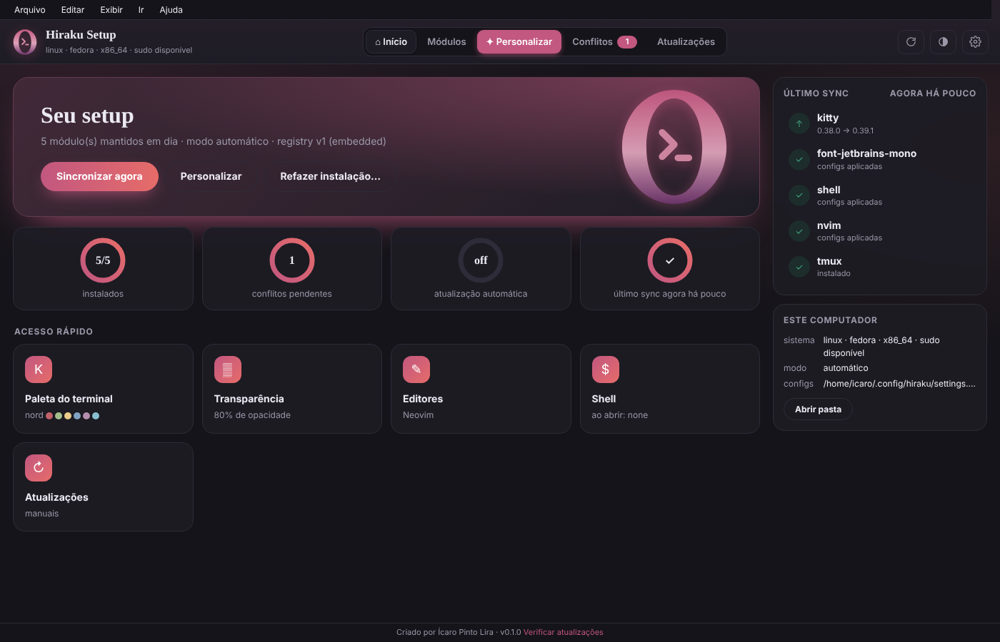
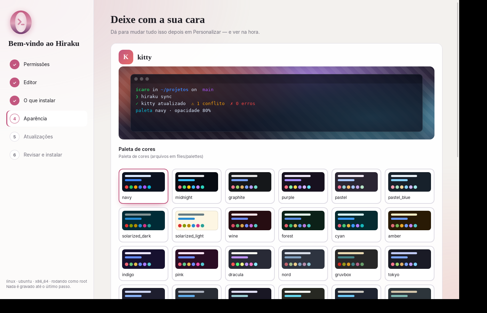
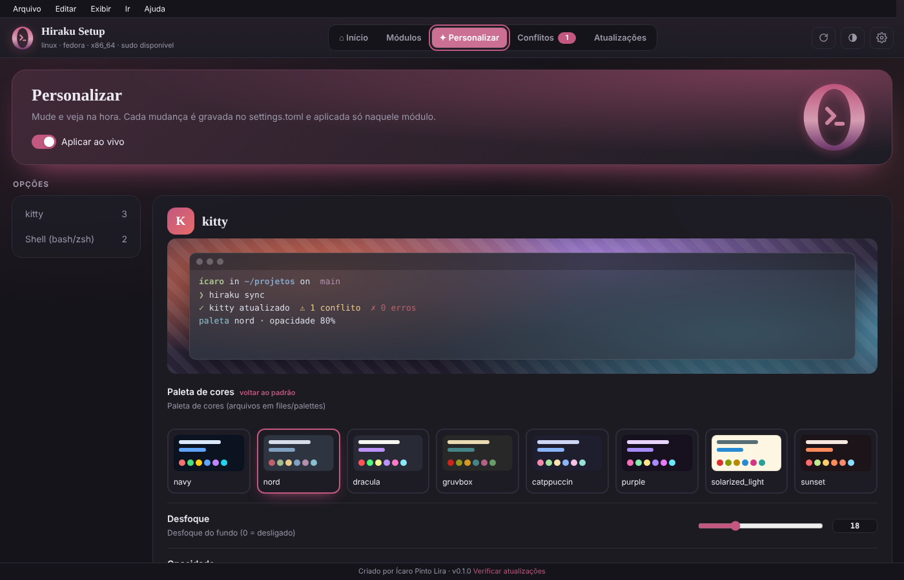

# Hiraku Setup Manager

Instala e mantém o setup do Ícaro — **kitty, tmux, Vim/Neovim, o shell e utilitários**
(starship, eza, bat, zoxide, fzf, fastfetch, ripgrep, Node, JDK, Nerd Font) — num app
desktop que depois vira o hub de configuração.



## Instalar

Baixe o instalador do seu sistema na [última release](https://github.com/IcaropLira/HirakuSetupManager/releases/latest):

| Sistema | Arquivo |
|---|---|
| Ubuntu / Debian | `.deb` |
| Fedora | `.rpm` |
| Qualquer Linux | `.AppImage` |
| macOS | `.dmg` |
| Windows | `.msi` ou `-setup.exe` |

Na primeira vez o app abre um assistente: se você tem sudo, qual editor, o que instalar,
paleta/transparência do terminal e se quer atualização automática. Nada é gravado até o
último passo.



## Depois de instalado

- **Personalizar**: paleta do kitty, opacidade, desfoque, visualizer do shell… Cada mudança
  é aplicada na hora (as janelas abertas do kitty recarregam sozinhas).
- **Módulos**: liga/desliga o que o hiraku mantém, fixa versões.
- **Conflitos**: se você editou um arquivo que o hiraku também quer mudar, nada é
  sobrescrito — você vê o diff e escolhe.
- **Atualizações**: tudo se atualiza sozinho:
  - **programas e configs**: um sync agendado (6 h ou diário) baixa o registry assinado
    publicado neste repositório e instala as versões novas;
  - **o próprio app**: procura versão nova ao abrir e a cada 6 h, baixa em segundo plano
    e só pede para reiniciar.



No terminal, o mesmo programa responde como `hiraku` (`.deb`/`.rpm`): `hiraku` abre a
versão de terminal (TUI), `hiraku sync`, `hiraku set kitty palette=nord`, `hiraku --help`.

## Como as atualizações chegam

```
GitHub Actions                                   seu computador
──────────────                                   ──────────────
registry.yml (toda segunda)                      sync agendado (systemd/launchd/schtasks)
  hiraku registry bump → versões novas             baixa registry.tar.gz + .minisig
  commit no main                                   confere a assinatura (keys/registry.pub)
  assina (minisign) → release "registry"   ───►    instala o que mudou

tag v* → release.yml                             app aberto
  instaladores + latest.json assinado      ───►    tauri-plugin-updater baixa e instala
```

## Desenvolvimento

Veja [docs/DESENVOLVIMENTO.md](docs/DESENVOLVIMENTO.md) (arquitetura, CLI, registry,
como rodar e publicar). Resumo:

```sh
cargo test --workspace --exclude hiraku-gui
cargo run -p hiraku-gui            # app (Linux: libwebkit2gtk-4.1-dev)
cargo run -p hiraku-cli -- tui     # versão de terminal
```

Publicar uma versão do app: `git tag v0.2.0 && git push origin v0.2.0`.

## Instalador antigo

O `install.sh` em shell continua em [`legacy/`](legacy/) e funciona como antes
(`legacy/install.sh`). Os arquivos de configuração foram migrados para `registry/modules/`.

---

Criado por Ícaro Pinto Lira.
